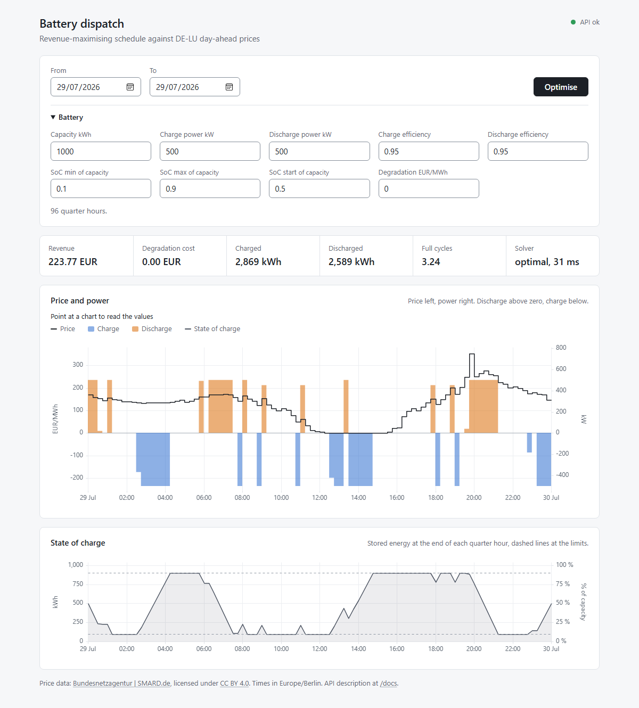

# battery-dispatch-demo

Dispatch planning for a battery storage system against day-ahead electricity prices. The
application fetches wholesale prices for Germany from the open SMARD API of the German
Federal Network Agency, stores them in TimescaleDB and computes a revenue-maximising
charge and discharge schedule.

A small demonstration project, not a product. Price import, optimisation and a web page
with the schedule work. A comparison with a simple strategy is not included.



## Quick start

Requirements:

- Docker with docker compose, running (Docker Desktop on Windows and macOS).
- Internet access: the first start downloads about 700 MB of images and Python
  packages, and prices come from SMARD.
- Free ports 5432 and 8000, or other ports set as `DB_PORT` and `API_PORT` in `.env`.

```bash
cp .env.example .env
docker compose up --build
```

Then open <http://localhost:8000/>. The page computes today's schedule and loads missing
prices from SMARD on its own, see [docs/ui.md](docs/ui.md). The API is described at
<http://localhost:8000/docs> and in [docs/api.md](docs/api.md), with examples.

## Documentation

[docs/README.md](docs/README.md) says which document answers which question.

## How it was built

Built with AI coding agents (Claude Code) under the author's direction. The author sets
goals and scope, reviews and approves the design and every plan, and decides what is merged;
agents write the code, tests and documents. Plans and review findings are in
[docs/plans/](docs/plans/), the process in [docs/workflow.md](docs/workflow.md).

## License

MIT, see [LICENSE](LICENSE). The bundled chart library uPlot is MIT licensed as well, see
`battery_dispatch/communication/http/frontend/vendor/LICENSE`.

Price data: Bundesnetzagentur | [SMARD.de](https://www.smard.de), licensed under
[CC BY 4.0](https://creativecommons.org/licenses/by/4.0/).
