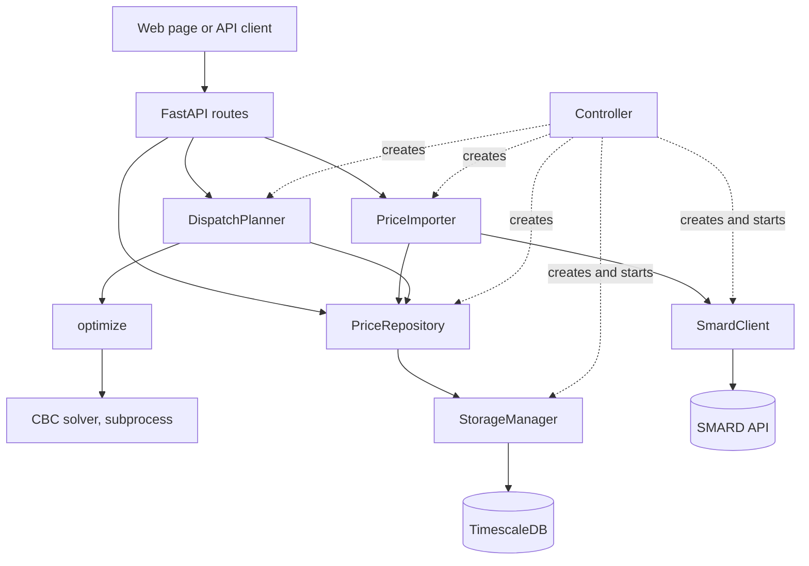

# Architecture

This document answers how the parts of the application work together. Why it is built this
way is in the [decisions](decisions/); the rules of the API are in [api.md](api.md).

## Components

The application is one process. A `Controller` creates all parts from the configuration and
passes each part what it depends on. Parts with their own start, stop and health check derive
from `ComponentBase` and are called components.

| Part | Package | Role | Component |
| --- | --- | --- | --- |
| `Controller` | `core/` | Creates the parts, starts and stops the components, collects health | owner |
| `StorageManager` | `storage/` | Owns the database engine, hands out sessions | yes |
| `SmardClient` | `market_data/` | Fetches prices from SMARD over HTTP | yes |
| `PriceRepository` | `storage/repositories/` | Reads and writes prices | no |
| `PriceImporter` | `market_data/` | Fetches prices and stores them | no |
| `DispatchPlanner` | `optimization/` | Loads prices, checks that they are complete, runs the optimiser | no |
| `optimize` | `optimization/` | Function that builds and solves the model, see [optimisation.md](optimisation.md) | no |
| FastAPI application | `communication/http/` | Routes, validation, error mapping, the web page | outer layer |

Apart from `main`, nothing imports `communication/http/`, so tests can exercise the lower parts
without a server. `optimize` knows neither the database nor HTTP. Routes reach the parts through the
FastAPI dependencies in `communication/http/dependencies.py`, which read them from the
controller.

## Startup and shutdown

1. `main` loads the configuration, sets up logging, creates the controller and the FastAPI
   application, and starts the server.
2. The FastAPI `lifespan` calls `Controller.running()`, which starts `storage`, then `smard`.
3. Neither start opens a connection. The database connects on first use, so the application
   also starts while the database is down.
4. If a start fails, the components already started are stopped and the error is passed on.
5. On shutdown the components stop in reverse order. A failing stop is logged and the
   remaining components still stop.

`GET /health` asks every component and answers 503 if one is down. `storage` runs `SELECT 1`
with a timeout. `smard` only reports whether it was started, because SMARD is needed for
imports and nothing else.

The schema comes from Alembic migrations. The container runs `alembic upgrade head` before it
starts the application, so there the database must be reachable at start; a later outage does
not stop the application. For a run on the host the migration is a manual step, see
[development.md](development.md).

## Importing prices

`POST /prices/import` with a time range:

1. `PriceImportRequest` validates the range and converts it to UTC.
2. `PriceImporter.import_range` calls `SmardClient.fetch_prices`. The client reads the index
   of weekly packages, fetches each package that overlaps the range one after the other,
   drops values that are not published yet and keeps the points inside `[start, end)`.
3. Only after that does `PriceRepository.upsert` write, in one transaction. An
   `INSERT ... ON CONFLICT DO UPDATE` changes a row only if its price differs, so a repeated
   import writes nothing and returns `written: 0`.
4. The response carries the number of prices fetched and rows written.

A failure at SMARD therefore leaves the database untouched.

## Optimising a schedule

`POST /dispatch/optimize` with a time range and battery parameters:

1. `DispatchRequest` validates the range and the battery, see [api.md](api.md).
2. `DispatchPlanner.plan` loads the stored prices of the range through
   `PriceRepository.list_range`. It lists every expected quarter hour and compares. If one is
   missing, it raises `PricesIncompleteError` and the solver does not start. The API never
   imports or interpolates on its own.
3. The planner runs `optimize` in a worker thread through `asyncio.to_thread`, so the server
   keeps answering other requests.
4. `optimize` builds the model and starts CBC as a subprocess with a time limit and a relative
   gap from the configuration. It blocks its thread until CBC returns.
5. If CBC proved no optimum within the gap, `optimize` raises `OptimizationError`. Otherwise it
   reads the variables, sets values below 1e-6 to zero and computes the key figures from this
   cleaned schedule.
6. The route turns the `Schedule` into the response.

The web page uses `POST /dispatch/optimize`, `POST /prices/import` and `GET /health`. On a 409
it imports the range and repeats the optimisation once, see [ui.md](ui.md).

## Data

One table holds all data.

| Column of `day_ahead_prices` | Type | Meaning |
| --- | --- | --- |
| `bidding_zone` | `text` | [Bidding zone](problem.md), `DE-LU` for all imported prices |
| `time` | `timestamptz` | Start of the quarter hour |
| `price_eur_per_mwh` | `double precision` | Price, may be negative |

The primary key `(bidding_zone, time)` is what prevents duplicates. The table is a TimescaleDB
hypertable, partitioned by `time` into chunks of 30 days. Migration 0001 enables the extension,
migration 0002 creates the table. Schedules are computed on request and not stored.

## Errors

[api.md](api.md#errors) lists the status codes. They are set here:

| Raised | Status | Mapped in |
| --- | --- | --- |
| Validation error of a request model | 422 | `server.py` |
| `PricesIncompleteError` | 409 | `dispatch_routes.py` |
| `OptimizationError` | 500 | `dispatch_routes.py` |
| `SmardError` | 502 | `price_routes.py` |
| `SQLAlchemyError`, `StorageUnavailableError` | 503 | `server.py` |

`StorageUnavailableError` exists because connection failures arrive from asyncpg as `OSError`,
which SQLAlchemy passes on unwrapped. `StorageManager.session()` translates them, so routes
need no knowledge of the driver.
