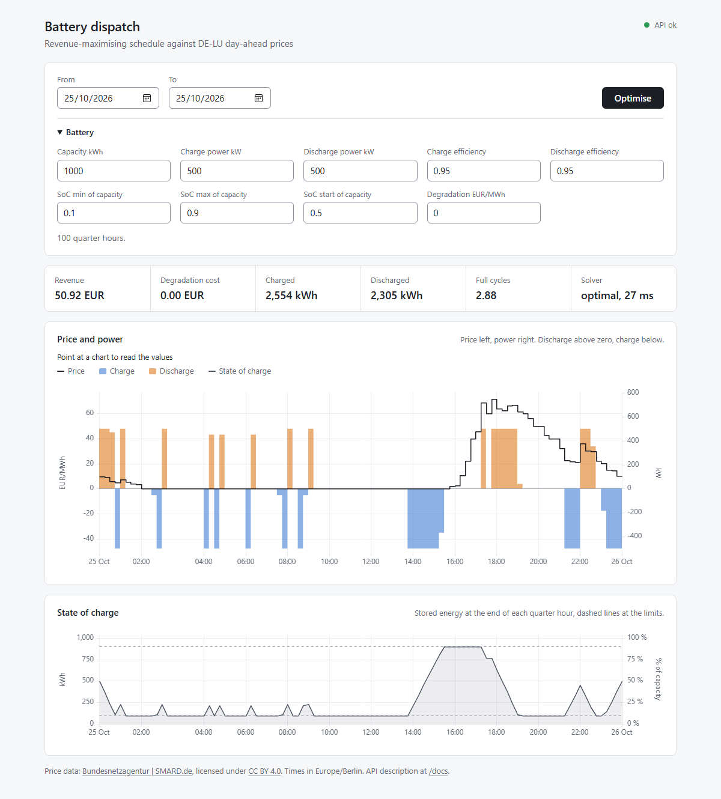

# Web page

The application serves a small page at <http://localhost:8000/ui/>; `/` redirects there.
It runs the optimisation for a range of days and shows the result. The page is plain
HTML, CSS and JavaScript under `battery_dispatch/communication/http/frontend/`, without a
build step. It uses only the API described in [api.md](api.md), so everything it shows can
also be fetched with `curl`.

## Use

- **From** and **To** are calendar days in Europe/Berlin; **To** is the last day included.
  Both default to today.
- **Battery** holds the parameters of `POST /dispatch/optimize` with the same defaults as
  the example in [api.md](api.md). Fractions such as efficiency and state of charge are
  entered as numbers between 0 and 1. Degradation is optional; left empty, the API
  default of 0 applies. Every other field is required.
- **Optimise** runs the request. The page also runs it once when it opens.
- The query parameters `from` and `to` (`YYYY-MM-DD`) prefill the range before that first
  run, for example `/ui/?from=2026-10-25&to=2026-10-25`.

## How it maps to the API

| Page | API |
| --- | --- |
| From, To | `start` is midnight of From, `end` is midnight after To, both with the Berlin offset of that day, for example `2026-10-25T00:00:00+02:00` and `2026-10-26T00:00:00+01:00` |
| Optimise | `POST /dispatch/optimize` |
| Prices missing | On 409 the page calls `POST /prices/import` for the same range and repeats the optimisation once |
| Key figures | `revenue_eur`, `degradation_cost_eur`, `charged_kwh`, `discharged_kwh`, `equivalent_full_cycles`, `solver` |
| Health indicator | `GET /health` on load and after every optimisation, green for `ok`, red otherwise; the tooltip lists the components |

The automatic import is a convenience of the page. The API itself stays explicit and never
imports on its own.

Error responses are shown as a sentence below the form: for 422 the first rejected field
and the reason, for 409 after the import how many quarter hours are still missing, and a
fixed explanation for 500, 502 and 503.

## Charts

- **Price and power.** The day-ahead price as a step line on the left axis, charge power
  (below zero) and discharge power (above zero) as bars on the right axis. Both axes share
  the zero line, so negative prices show below it.
- **State of charge.** Stored energy at the end of each quarter hour, starting from the
  initial state of charge, with the limits as dashed lines. The right axis shows the share
  of the capacity.
- Both charts share the cursor and the time axis. Dragging across a chart zooms into the
  range, a double click resets it. The line above the charts shows the values of the
  quarter hour under the cursor.
- Times are Europe/Berlin. On the day summer time ends, the hour from 02:00 appears twice,
  once as CEST and once as CET; the line above the charts names the offset. At full width
  that day has 2-hour ticks (02:00 CEST, then 04:00 CET); zoomed in, the axis labels
  02:00 twice.

## Details

- [uPlot](https://github.com/leeoniya/uPlot) 1.6.32 draws the charts. It is stored under
  `frontend/vendor/` with its MIT licence, so the page loads nothing from other servers.
- The page follows the light or dark setting of the operating system and works on narrow
  screens down to about 400 px.
- There are no automated browser tests. The route tests in
  `tests/communication/http/test_frontend.py` check that the files are served.

## Data

Price data: Bundesnetzagentur | [SMARD.de](https://www.smard.de), licensed under
[CC BY 4.0](https://creativecommons.org/licenses/by/4.0/). The page shows this attribution
below the charts.
